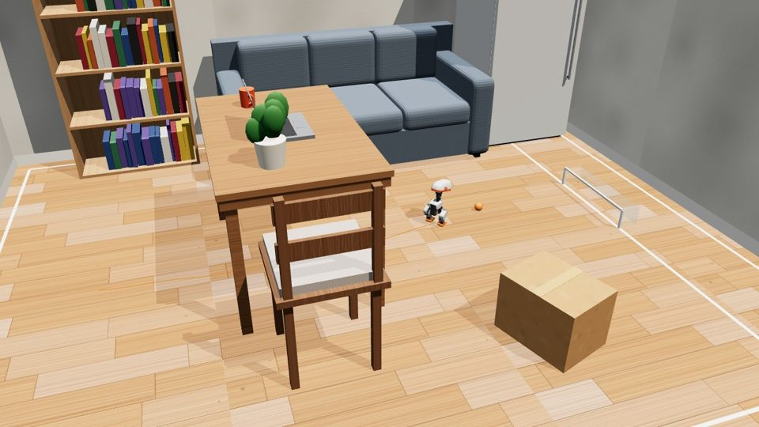
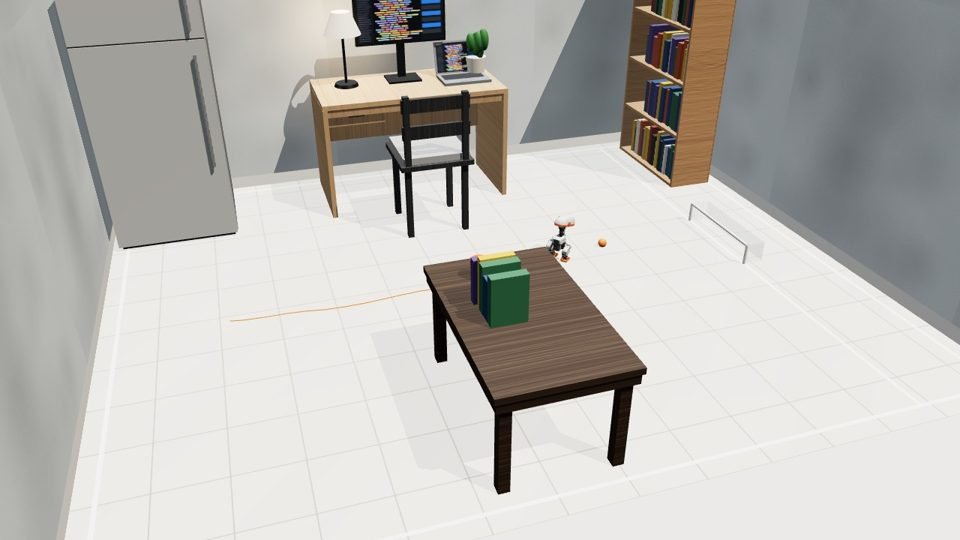
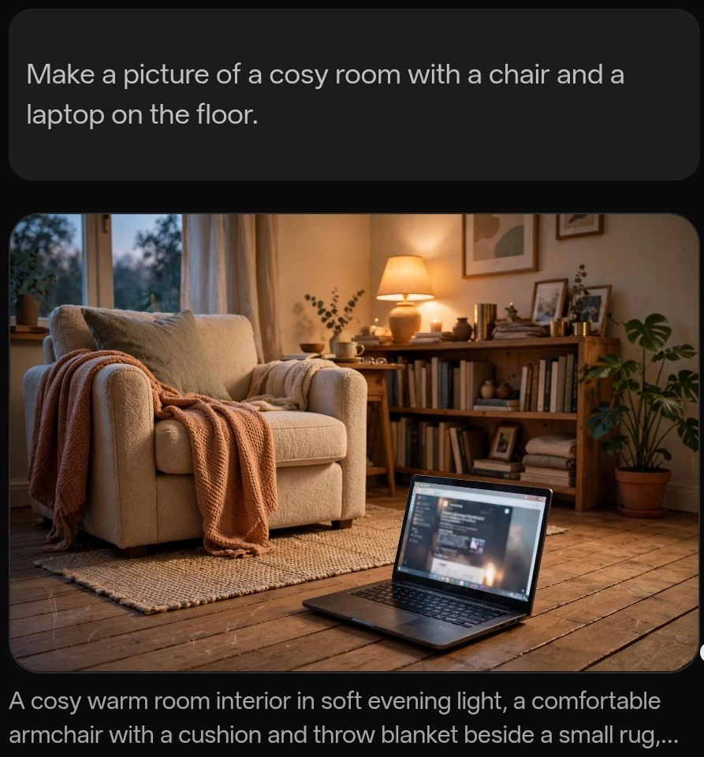

# robolance

<p align="center">
  <a href="https://cerebralvalley.ai"></a>
  <a href="https://ai.meta.com"></a>
  <a href="https://www.baseten.co"></a>
  <a href="https://fireworks.ai"></a>
  <a href="https://modal.com"></a>
</p>

**Tell what your robot should do in plain words; a Meta-powered agent codes, flashes, watches and fixes it until it works.**

<p align="center">
  <a href="https://github.com/google-deepmind/mujoco"></a>
  <a href="https://github.com/pollen-robotics/microduck"></a>
  <a href="https://github.com/facebookresearch/sam3"></a>
  <a href="https://github.com/microsoft/onnxruntime"></a>
  <a href="https://github.com/mrdoob/three.js"></a>
  <a href="https://github.com/eclipse-theia/theia"></a>
  <a href="https://github.com/modelcontextprotocol/typescript-sdk"></a>
  <a href="https://github.com/wokwi/avr8js"></a>
  <a href="https://github.com/wokwi/wokwi-elements"></a>
  <a href="https://github.com/arduino/ArduinoCore-avr"></a>
  <a href="https://github.com/facebook/react"></a>
</p>

robolance is an [OpenLance](https://openlance.ai) feature built in the open for the Meta Global AI Developer Hackathon (October 26 – November 4, 2026). It gives a coding agent a real feedback loop for embedded code: compile an Arduino sketch, run it on a simulated board wired to real parts (LEDs, buttons, servos, motors, an ultrasonic sensor), drive a two-wheel robot through an arena, and read back exactly what the firmware did. The agent iterates on that trace the way it iterates on a failing test, and the user watches the circuit, the robot and the run history in the browser. No hardware is needed; when a board is plugged in, the same sketch flashes to it.

The same loop works for robots that walk. [Microduck](https://github.com/pollen-robotics/microduck), Pollen Robotics' 25 cm open-source duck robot, runs in a MuJoCo physics simulator with its own trained skills. The agent writes a mission ("score a goal", "close the developer's laptop"), runs it, reads why a kick missed or the lid stayed open, and runs again. It can turn a photo of a room into obstacles with Meta's SAM 3.1, make pictures from plain words with Muse Image right in the chat, and train new skills on the user's own GPU provider. Any other robot comes in as a MuJoCo model the agent checks and drives with a controller script.

## What is pre-existing and what is new

- **Pre-existing**: OpenLance, the web IDE and agent harness this plugs into (separate repository, not part of the hackathon submission). Open-source libraries: [avr8js](https://github.com/wokwi/avr8js) (ATmega328p emulation, MIT), [@wokwi/elements](https://github.com/wokwi/wokwi-elements) (part graphics, MIT), avr-gcc and [ArduinoCore-avr](https://github.com/arduino/ArduinoCore-avr), the [Model Context Protocol SDK](https://github.com/modelcontextprotocol/typescript-sdk), [MuJoCo](https://github.com/google-deepmind/mujoco) (physics, Apache-2.0), [ONNX Runtime](https://github.com/microsoft/onnxruntime) (MIT), and Pollen Robotics' Microduck robot model and trained skills (walk, stand, kicks; Apache-2.0; see `packages/duck-sim/THIRD_PARTY_NOTICES.md`).
- **New, written during the event, in this repository**: everything under `packages/` and `demo/`: the circuit and robot-arena simulation (wall avoidance and line following), the compile and run tools served over MCP, the IDE extension that shows the circuit, arena and runs (with the arena editor, the wiring check from a photo and shareable run links), and the replay page. Also the Microduck simulator and mission API (football pitch, obstacles, the laptop mission, scoring and notes), the `duck_*` and `scene_*` tools, photo-to-obstacles from SAM 3.1 output, running policies a project trained, the generic MuJoCo runner for any robot, and the 3D replay views.
- **New, written during the event, in OpenLance** (separate repository): the agent prompting and the closed compile-run-fix loop around the tools, the Meta model provider, image generation with Muse Image (the picture appears in the chat as it is made), SAM 3.1 segmentation and photo-to-obstacles from plain words, GPU training jobs on the user's own compute provider, and the glue that hosts the extension (preview tabs, photo attachments, robot template, built-in hardware tools, sandbox toolchain).

## Packages

| Package | What it is |
|---|---|
| `packages/hardware-sim` | `robolance-hardware-sim`: an Arduino Uno (avr8js) with functional part models, a `diagram.json` circuit format, a deterministic robot arena, and `runScenario()` which runs firmware with scripted inputs and returns a trace. Runs in Node and the browser. |
| `packages/hardware-tools` | `robolance-hardware-tools`: the agent's tools. `buildSketch()` compiles a sketch with arduino-cli or plain avr-gcc + ArduinoCore-avr. `createHardwareServer()` serves `hardware_parts`, `hardware_compile`, `hardware_run` and `hardware_arena` over MCP; `robolance-tools` is the stdio entry point. |
| `packages/openlance-hardware` | `robolance-openlance-hardware`: the OpenLance (Theia) extension. It adds a Hardware tab to the preview with a Circuit view (Wokwi part graphics wired to the Uno), an Arena view (walls, path, robot, sensor ray) and a Runs view (score curve across runs, serial output, notes). A scrubber replays the agent's last recorded run; "Go live" runs the built firmware in the browser so you can press the buttons and turn the knobs yourself. |
| `packages/mujoco-sim` | `robolance-mujoco`: any robot from its MuJoCo MJCF. `Scene.check()` reports actuators, sensors, mass, overlapping parts and stability; `Scene.run()` drives it with a controller script and records a replay; the viewer model lets a browser show it in 3D. |
| `packages/duck-sim` | `robolance-duck-sim`: Microduck on a football pitch, built on `robolance-mujoco`. Pollen Robotics' trained skills run at 50 Hz on 200 Hz physics. `runMission()` runs a mission program and returns the outcome, a score, notes on what went wrong, and a replay. The pitch can carry obstacles and a laptop with a hinged lid. |
| `demo/` | The replay page. "Share this run" in the Runs view makes a link that carries the run (deflated into the fragment, nothing uploaded); the page replays it with the same views, for anyone, without an account. Published from `main` to GitHub Pages at https://robolance.openlance.ai/replay/. |

## The loop

1. The user says what the robot should do.
2. The agent writes `sketch.ino` and `diagram.json` (parts and pins; optionally an arena binding).
3. `hardware_compile` returns the compiler's errors or the flash size.
4. `hardware_run` runs the sketch for a few simulated seconds with scripted button presses, sensor values or serial input, and returns serial output, part states over time, the robot's path, collisions and a score 0–100, plus notes such as "led1 never turned on" or "the robot never moved: check the motor pins".
5. The agent reads the trace, fixes the sketch, and runs again until the behaviour matches.

A 20 s arena run takes about 6 s of wall-clock time; a 3 s bench run about 1.4 s.

## Microduck

The agent reads `duck_api`, writes a mission and calls `duck_run`:

```js
const b = duck.ball();
await duck.walkTo(b.x - 0.25, b.y + 0.05);   // behind the ball, a little to its left
await duck.turnTo(0);                        // face the goal
await duck.walkForward(duck.ballRelative().forward - 0.07);
await duck.kick('right');
```

Each run returns the outcome (`goal`, `no-goal`, `closed`, `still-open`, `fell`, `time-up`), a 0–100 score, every kick, the duck's path and notes that say what went wrong ("2.1 s: right kick missed - the ball was 10 cm ahead and 3 cm to the right. It needs to be 6-8 cm ahead and 1.5-8 cm to the right."). Runs are recorded into the project; the Hardware tab replays them in 3D and shares any run as a link.

- **Score a goal**: `examples/score-a-goal.js` scores from anywhere on the default pitch.
- **Close the laptop**: with `field.laptop` set, the duck walks behind the open laptop and headbutts the lid shut (`examples/close-the-laptop.js`, scores 88–96 from any placement). The developer has to come and play.
- **Obstacles from a photo**: SAM 3.1 finds the boxes in a top-down photo; `duck_obstacles_from_photo` maps them onto the pitch as `field.obstacles`, and the duck walks around them. A chair, table, desk, fridge, shelf or sofa it finds comes back as that piece of furniture at real size.
- **Rooms and furniture**: `field.room` puts the pitch indoors (wood, tile, carpet or concrete floor, painted walls) and `field.furniture` adds real-size pieces: a fridge, a table or desk with a laptop, monitor, lamp or plant on top, chairs, a bookshelf, a sofa, boxes, each with its own place, size and colour. Only what stands on the floor is solid (a table's legs, a fridge's body), so the 26 cm duck walks under tables and chairs, and a note names what it bumped into.

<p align="center"> </p>
- **Trained skills**: a policy the project trained (ONNX, 61 inputs, 14 outputs) replaces the built-in walk or adds a new skill, so a new skill is tested in the same simulator before anyone calls it done.

## Pictures with Meta models

Image generation is new in OpenLance, built for this hackathon on Meta's models. Everything runs on the user's own Meta key, saved once in Settings and never sent to the sandbox.

<p align="center"></p>

- **Make a picture (Muse Image)**: ask in plain words, e.g. "Make a picture of a cosy room with a chair and a laptop on the floor." The chat shows one card in the picture's shape that glows while Muse Image draws it; the picture fades in inside the same card, with the prompt as its caption. It is saved in the project (`images/` by default) and opens full size on a click. Muse Image makes pictures from words; it does not edit a photo.
- **Find things in a photo (SAM 3.1)**: the agent finds every "chair" or "cardboard box" in a project image and gets back a mask and a box for each.
- **Your room as the pitch**: attach a photo of a room and say "Make the duck walk around the chair and score a goal." The agent finds the things standing on the floor with SAM 3.1, estimates the floor from things of known size (a chair seat is about 45 cm), turns them into `field.obstacles` with `duck_obstacles_from_photo` and runs the mission. No tool names or measurements needed.
- **Test photos for SAM**: with no photo to hand, have Muse Image make one first ("a top-down photo of cardboard boxes on a wooden floor"), then turn it into obstacles.

## Run it

```sh
npm install
npm run build
npm test
```

The MCP tests use a prebuilt fixture and need no compiler. To compile sketches you need either `arduino-cli` on the PATH (with `arduino:avr` installed) or the Debian packages `gcc-avr binutils-avr avr-libc` plus a checkout of ArduinoCore-avr:

```sh
git clone --depth 1 https://github.com/arduino/ArduinoCore-avr /opt/arduino/core
git clone --depth 1 https://github.com/arduino-libraries/Servo /opt/arduino/libs/Servo
export ROBOLANCE_ARDUINO_CORE=/opt/arduino/core
export ROBOLANCE_ARDUINO_LIBS=/opt/arduino/libs
npm test                      # now also runs the compiler tests
node scripts/bench-smoke.mjs  # compile + run the bench circuit
node scripts/arena-smoke.mjs  # compile + drive the robot
```

Every successful compile writes `.robolance/firmware.hex` and `.robolance/build.json` into the working directory, and every run writes `.robolance/runs/<timestamp>.json` (the last 30 are kept). The IDE's Hardware tab reads those files. Set `ROBOLANCE_RECORD_DIR` to write elsewhere, or to an empty string to record nothing.

To use the tools from any MCP client, point it at:

```json
{ "command": "node", "args": ["packages/hardware-tools/lib/cli.js"] }
```

## How the IDE tab plugs in

The extension binds `Symbol.for('openlance.previewTab')` in its inversify module with an object `{ id, label, applies(files), render(context) }`; OpenLance's preview panel resolves every such binding and shows the tabs that apply to the open project. `context.files` is the project's files by path, so the tab needs nothing but the files the tools write.

## Diagram format

```json
{
  "board": "uno",
  "parts": [
    { "type": "led", "id": "led1", "pin": 13, "color": "green" },
    { "type": "button", "id": "btn", "pin": 2 },
    { "type": "servo", "id": "arm", "pin": 9 },
    { "type": "potentiometer", "id": "pot", "pin": "A0" },
    { "type": "ultrasonic", "id": "eyes", "trig": 12, "echo": 11 },
    { "type": "motor", "id": "left", "in1": 4, "in2": 5, "en": 6 },
    { "type": "motor", "id": "right", "in1": 7, "in2": 8, "en": 10 }
  ],
  "arena": { "preset": "corner", "left": "left", "right": "right", "sensor": "eyes" }
}
```

Buttons are wired to ground (use `INPUT_PULLUP`, pressed reads LOW). Servos take the Arduino `Servo` library's pulses. The HC-SR04 answers a 10 µs trigger pulse with an echo of 58 µs per centimetre. Motors are one H-bridge channel each: two direction pins and a PWM enable. The corner arena is a 200 × 120 cm room with two inner walls; the robot starts bottom-left facing east and the goal is top-right.

## Thanks

robolance was built for the **Meta Global AI Developer Hackathon**. Thank you to:

- **[Cerebral Valley](https://cerebralvalley.ai)** for organizing the hackathon and bringing everyone together.
- **[Meta](https://ai.meta.com)** for the Llama and Muse models the agent thinks with, and SAM 3.1, which turns a photo of a room into obstacles.
- **[Baseten](https://www.baseten.co)** and **[Fireworks AI](https://fireworks.ai)** for serving Muse Spark Open fast enough for a coding agent's loop.
- **[Modal](https://modal.com)** for the GPUs that train new Microduck skills.

And to the open-source projects at the top of this page, which robolance is built on.

## License

Apache-2.0. See `LICENSE`.
